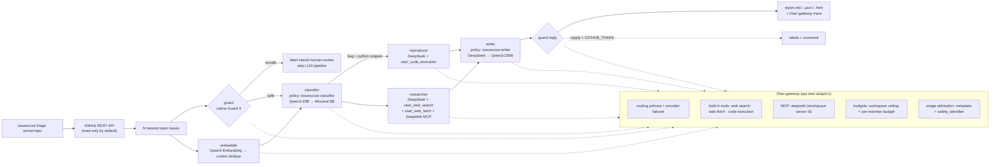

# IssueScout 🔎

**An open-source GitHub issue-triage agent, built on [Mozilla Otari](https://otari.ai).**

Point it at any public repo. IssueScout pulls the newest open issues and, for each one:

1. **screens** the untrusted issue text with an open safety model (Llama Guard 4),
2. **detects likely duplicates** across the batch with open embeddings (Qwen3-Embedding),
3. **classifies** it (bug / feature / question / docs / duplicate), **suggests labels and a priority** (Qwen3-30B-A3B, JSON mode),
4. **tries to reproduce** bugs that include a Python snippet, inside Otari's **sandboxed code execution**,
5. **researches** related docs and known fixes with Otari's **web search + web fetch** and a **DeepWiki MCP server**,
6. **drafts a polite maintainer reply** (DeepSeek V4.1 Flash), then screens the draft with the guard model again.

You get `report.md`, `report.json` and a static `report.html`. **It's a dry run by default.** Nothing is
written to GitHub unless you pass `--apply` *and* set `GITHUB_TOKEN`.

➡️ Sample real runs: [`examples/report.md`](examples/report.md) ([HTML](examples/report.html)) on 4 live
`mozilla-ai/otari` issues, and [`examples/repro-colorlog/report.md`](examples/repro-colorlog/report.md), where
the sandbox **actually reproduced** a reported bug in `borntyping/python-colorlog#143`.

---

## Quick start

```bash
git clone https://github.com/ridakalam52-design/issuescout && cd issuescout
git checkout otari-hackathon
pip install -e .                      # stdlib only, no runtime dependencies

export OTARI_API_KEY=otk_...          # workspace API key from otari.ai → API Keys
# optional:
export GITHUB_TOKEN=ghp_...           # higher GitHub rate limits; required only for --apply
export ISSUESCOUT_MCP_SERVER_IDS=<uuid>   # use the workspace-registered DeepWiki MCP server (else inline)

issuescout doctor                     # checks Otari tools + every role's model chain
issuescout triage mozilla-ai/otari --limit 5 --out out --user alice --max-spend 0.10
issuescout triage borntyping/python-colorlog --issue 143 --out out/colorlog
open out/report.html
```

Useful flags: `--engine heuristic` (offline rules, no models), `--no-repro`, `--no-research`,
`--issue N` (repeatable), `--max-spend USD` (client-side cap, default $0.10), `--user ID` (per-user cost attribution),
`--apply` (write labels + reply comments; needs `GITHUB_TOKEN`).

Tests (gateway and GitHub fully mocked, no network, no spend):

```bash
python -m unittest discover tests     # 16 tests
```

Cost: a 4-issue run with research costs about **$0.04** on Otari (most of it is the $0.01-per-call web search;
a sandbox repro adds about $0.01). Classification, guarding, embeddings and reply writing together are under $0.001 per issue.

---

## Otari features used (mapped to the judging rubric)

Every feature below is exercised by the sample runs in `examples/`. Each issue's report has a collapsible
**"Otari gateway trace"** with the model or routing policy requested, the model and provider that actually served it
(`Otari-Model` / `Otari-Provider` headers), whether a fallback happened (`Otari-Fallback`), the Otari tools called, and the cost.

| Rubric item | How IssueScout uses it | Where |
|---|---|---|
| **Open-weight models (≥2, different purposes)** | Llama Guard 4 12B (safety screen), Qwen3-30B-A3B-Instruct (classifier), Qwen3-Embedding-0.6B (duplicate detection), DeepSeek V4.1 Flash (researcher, sandbox driver, reply writer), with Qwen3-235B-A22B, Ministral 3 8B, Qwen3Guard and BGE-M3 as fallbacks. **All open-weight.** | [`issuescout/config.py` L15-29](issuescout/config.py#L15-L29) |
| **Multiple models serving distinct roles** | Six roles, each with its own model chain: guard / classifier / embedder / researcher / reproducer / writer | [`config.py` L15-29](issuescout/config.py#L15-L29), [`agent.py` L65-230](issuescout/agent.py#L65-L230) |
| **Model routing & fallbacks** | (1) **Otari routing policies** `issuescout-classifier` (Qwen3-30B → Ministral 8B) and `issuescout-writer` (DeepSeek V4.1 Flash → Qwen3-235B), created in the dashboard and called by name as `model`. (2) Catalog IDs (`vendor/model`) let Otari pick and fail over between providers for one model. (3) A client-side chain covers a workspace that hasn't created the policies yet. `Otari-Fallback`, `Otari-Attempt-Count` and the serving model are recorded per call. | [`otari_client.py` L149-191](issuescout/otari_client.py#L149-L191), [`config.py` L19, L28](issuescout/config.py#L19) |
| **Web search / web fetch** | The researcher declares `otari_web_search` (with `max_uses: 1` to bound cost) and `otari_web_fetch`. The sources Otari returns in `otari_tool_calls` are used to tag each related link as verified via web search/fetch or as coming from the model/MCP. | [`agent.py` L143-182](issuescout/agent.py#L143-L182), [`otari_client.py` L182-188](issuescout/otari_client.py#L182-L188) |
| **MCP integrations** | DeepWiki MCP server (`https://mcp.deepwiki.com/mcp`), registered in the workspace (Tools → MCP servers) and referenced by `mcp_server_ids`, or inlined via `mcp_servers` with an `allowed_tools` allow-list. Otari runs the MCP tool loop alongside web search in the **same request**. | [`config.py` L42-56](issuescout/config.py#L42-L56), [`agent.py` L155](issuescout/agent.py#L155) |
| **Code execution** | For bug reports that contain a Python snippet, the reproducer runs it in Otari's sandbox (`otari_code_execution`, `max_tool_iterations: 3`). Chat Completions doesn't report code-execution calls, so IssueScout checks the billed cost to confirm the sandbox really ran. If it didn't, the repro is marked *unverified*. | [`agent.py` L120-140](issuescout/agent.py#L120-L140) |
| **Budgets & spending limits** | Server side: an Otari budget `issuescout-hackathon` ($1.50/month) with a workspace **spend ceiling**. Client side: a run `Ledger` adds up `usage.cost_usd` from every response and refuses the next call past `--max-spend`. Otari's `402` / `budget_exceeded` responses become `BudgetExceeded`: the run stops cleanly and keeps heuristic results for the remaining issues. | [`otari_client.py` L78-93, L126](issuescout/otari_client.py#L78-L93), [`agent.py` L253-258](issuescout/agent.py#L253-L258) |
| **Per-user budgets** | A per-member daily budget `issuescout-per-user` ($1/day) is set on the workspace member in Otari. Every request carries `safety_identifier` + `metadata.user` (from `--user`) plus `metadata.role`/`run`, so Otari's usage view can split spend per end user and per role. | [`otari_client.py` L135-146](issuescout/otari_client.py#L135-L146), [`cli.py` L30, L66](issuescout/cli.py#L30) |
| **Guardrails** | Input and output guardrails on open safety models served by Otari: Llama Guard 4 screens each issue before any other model sees it (flagged issues get `needs-human-review` and skip the LLM pipeline), and screens each drafted reply before it's shown or applied. Request-level Otari `guardrails` entries (`ISSUESCOUT_GUARDRAIL_PROFILES`, monitor mode) are also sent, and the `Otari-Guardrails` verdict header is recorded. | [`agent.py` L65-79, L222-228, L247-251](issuescout/agent.py#L65-L79), [`config.py` L59-67](issuescout/config.py#L59-L67), [`otari_client.py` L161-162, L180](issuescout/otari_client.py#L161-L162) |

### One-time dashboard setup (already done for the demo workspace)

These were set up in the otari.ai dashboard for the demo workspace. To reproduce in your own workspace:

1. **Tools → Web search**: set *Web access* to **Allowed** and *Max results* to 5. Without this, `otari_web_search`/`otari_web_fetch`
   return `web search is not enabled for this workspace`. IssueScout then falls back to MCP-only research.
2. **Tools → Code execution**: **Allowed** (default).
3. **Tools → MCP servers → Add MCP server**: Name `deepwiki`, URL `https://mcp.deepwiki.com/mcp`, no token,
   purpose hint "Ask questions about public GitHub repositories' docs and code". Copy its UUID into `ISSUESCOUT_MCP_SERVER_IDS`.
4. **Routing → Create policy → Fallback**:
   - `issuescout-classifier`: main `alibaba/qwen3-30b-a3b-instruct-2507`, backup `mistralai/ministral-3-8b`
   - `issuescout-writer`: main `deepseek/deepseek-v4.1-flash-1017`, backup `alibaba/qwen3-235b-a22b-instruct-2507`
5. **Organization → Spend & Budgets**: *Add budget* `issuescout-hackathon` ($1.50, Monthly) → *Add ceiling* capping the workspace.
   For a per-user cap: *Add budget* `issuescout-per-user` ($1.00, Daily), then **Members & roles → Edit member →
   Budget in workspace** = `issuescout-per-user`.
6. *(Optional)* **Organization → Guardrails**: every hosted check (prompt injection, PII, …) needs a third-party vendor key
   (Lakera, Patronus, Azure, …). If you add one, mandate it on the workspace and/or set
   `ISSUESCOUT_GUARDRAIL_PROFILES=<profile>`. IssueScout's built-in Llama Guard screening works without any of this.

---

## Architecture



Code map:

- [`issuescout/otari_client.py`](issuescout/otari_client.py): the only module that talks to Otari (stdlib `urllib`). Handles model chains, trace headers, cost ledger, budget errors and attribution.
- [`issuescout/config.py`](issuescout/config.py): role → model chain (override any with `ISSUESCOUT_MODELS_<ROLE>`), MCP and guardrail settings.
- [`issuescout/agent.py`](issuescout/agent.py): the pipeline. Every step degrades gracefully to the heuristic result.
- [`issuescout/heuristics.py`](issuescout/heuristics.py): the pre-Otari rule-based baseline (still used offline and as the fallback).
- [`issuescout/github.py`](issuescout/github.py), [`issuescout/report.py`](issuescout/report.py), [`issuescout/cli.py`](issuescout/cli.py).

## Safety notes

- Issue text and fetched web pages are treated as untrusted. They're screened by the guard model, wrapped in `<issue>` tags, and every system prompt tells the model to ignore instructions inside them.
- Dry run by default. `--apply` is the only code path that writes to GitHub, and it refuses to run without `GITHUB_TOKEN`.
- The Otari key is read from `OTARI_API_KEY` and is never logged or written to a report (a test checks this).

## History / hackathon note

`main` holds the pre-Otari skeleton (rule-based triage only). Otari was introduced on the
[`otari-hackathon`](https://github.com/ridakalam52-design/issuescout/tree/otari-hackathon) branch in commit
[`efecfa0`](https://github.com/ridakalam52-design/issuescout/commit/efecfa076db93b31857060487e5f356a5226c099).

## AI-assistance disclosure

This project was built with substantial help from an AI agent (Hark, an LLM-based assistant) working for the author. It read the
Otari docs, wrote most of the code, tests and docs, and ran the sample triage runs through Otari. The author chose the
project and its direction and reviewed the result. The draft replies in `examples/` are model output and were not posted anywhere.

## License

MIT. See [LICENSE](LICENSE).
